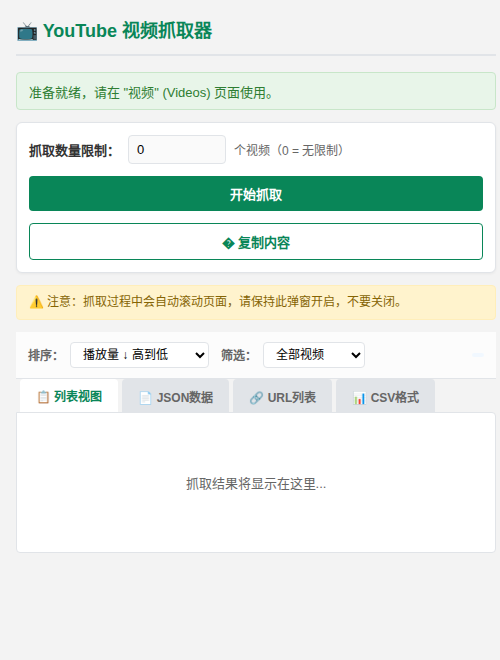

<p align="right"><a href="README.md">中文</a></p>

<p align="center">
  
</p>

<p align="center">
  <a href="https://github.com/holynova/youtube-channel-scraper-chrome/releases/tag/v1.2.0">⬇ Download v1.2.0</a>
  ·
  <a href="https://github.com/holynova/youtube-channel-scraper-chrome">GitHub Repository</a>
</p>

YouTube Channel Scraper is a Chrome extension (Manifest V3): open any YouTube channel's Videos page, click Start, and it auto-scrolls to load every video — extracting title, URL, views, publish time, and members-only status — then exports as JSON, a URL list, or CSV with one click. Playlist pages work too.

## Screenshot

<p align="center">
  
</p>

## Install

1. Download `youtube-scraper-v1.2.0.zip` from [Releases](https://github.com/holynova/youtube-channel-scraper-chrome/releases/tag/v1.2.0) and unzip it (or use the `youtube-scraper-extension/` folder in the repo directly).
2. Open Chrome, go to `chrome://extensions/`, and turn on **Developer mode** in the top right.
3. Click **Load unpacked** and select the unzipped `youtube-scraper-extension` folder.

This extension is not listed on the Chrome Web Store; it must be loaded manually.

## How to Use

1. Open any YouTube channel's **视频 (Videos)** page (e.g. `https://www.youtube.com/@channel/videos`), or a playlist page.
2. Click the extension icon in the top right of the browser.
3. (Optional) Set a **抓取数量限制 (max-video limit)** in the input box (0 = unlimited).
4. Click **开始抓取 (Start)**. The page auto-scrolls to load videos; keep the popup open while it runs — don't close it.
5. Click **停止抓取 (Stop)** anytime to interrupt; already-loaded data is kept.

## Features

- **Scraped fields**: title, URL, views (parsed to a number), publish time (parsed to a date), and members-only status.
- **4 export formats**: 列表视图 (list view — copy the link per row), JSON 数据 (JSON data with syntax highlighting), URL 列表 (URL list), and CSV 格式 (CSV — a single line of comma-joined URLs); each tab has a one-click copy button.
- **Global sort & filter**: sort by views (high→low / low→high) or time (new→old / old→new); filter 全部 (all) / 会员专属 (members-only) / 非会员 (non-members). Sort and filter apply across all views.
- **Limit & stop anytime**: set a maximum video count and it stops when reached; stopping mid-run keeps the data already scraped.
- **Playlist support**: URLs containing `playlist` or `list=` automatically switch to playlist mode.

## Tech

- Manifest V3, zero dependencies: 3 files (`manifest.json`, `content.js`, `popup.html` + `popup.js`).
- Minimal permissions: only `activeTab` and `scripting`; the content script matches `*://www.youtube.com/*` only.
- Scraping logic lives in `content.js`: scroll to the bottom, wait for new content to load, and repeat until no new videos appear or the limit is reached; titles and links are extracted with `#video-title` and `#video-title-link`, views and publish time are parsed from the metadata line, and members-only status is read from the badge.
- Packaging: `npm run package` builds `dist/youtube-scraper-v1.2.0.zip`; pushing a `v*` tag triggers a GitHub Action that creates a Release with the zip attached.

```
youtube-scraper-extension/
  manifest.json         Manifest V3, v1.2.0; permissions activeTab, scripting
  content.js            Scraping logic: auto-scroll, video parsing, playlist mode
  popup.html            Popup UI: green-and-white theme, 4 tabs
  popup.js              Popup logic: sort / filter / export / copy
dist/                   Packaged zip (v1.2.0)
docs/requirement.md     Requirements document
.github/workflows/      release.yml: tag push auto-creates a Release
```
