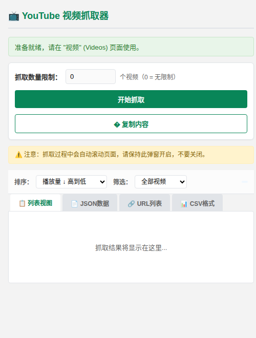

<p align="center">
  
</p>

<p align="center">
  <a href="https://github.com/holynova/youtube-channel-scraper-chrome/releases/tag/v1.2.0">⬇ 下载 v1.2.0 Download</a>
  ·
  <a href="https://github.com/holynova/youtube-channel-scraper-chrome">GitHub 仓库</a>
</p>

YouTube 频道抓取器是一款 Chrome 扩展（Manifest V3）：打开任意 YouTube 频道的「视频」页面，点一下开始抓取，它会自动滚动加载全部视频，提取标题、链接、播放量、发布时间与会员专属状态，再一键导出 JSON、URL 列表或 CSV。播放列表页面同样可用。

YouTube Channel Scraper is a Chrome extension (Manifest V3): open any YouTube channel's Videos page, click Start, and it auto-scrolls to load every video — extracting title, URL, views, publish time, and members-only status — then exports as JSON, a URL list, or CSV with one click. Playlist pages work too.

## 截图 / Screenshots

<p align="center">
  
</p>

## 安装 / Install

1. 在 [Releases](https://github.com/holynova/youtube-channel-scraper-chrome/releases/tag/v1.2.0) 下载 `youtube-scraper-v1.2.0.zip` 并解压（或直接用仓库里的 `youtube-scraper-extension/` 文件夹）。
2. 打开 Chrome，进入 `chrome://extensions/`，打开右上角的**开发者模式**。
3. 点击**加载已解压的扩展程序**，选择解压后的 `youtube-scraper-extension` 文件夹。

本扩展未上架 Chrome 应用商店，需手动加载。

## 使用 / How to Use

1. 打开任意 YouTube 频道的**视频 (Videos)** 页面（例如 `https://www.youtube.com/@channel/videos`），或一个播放列表页面。
2. 点击浏览器右上角的扩展图标。
3. （可选）在输入框中设置**抓取数量限制**（0 表示无限制）。
4. 点击**开始抓取**。页面会自动向下滚动加载视频；抓取过程中请保持此弹窗开启，不要关闭。
5. 随时可以点**停止抓取**中断，已加载的数据会保留下来。

## 功能 / Features

- **抓取字段**：标题、链接、播放量（解析为数字）、发布时间（解析为日期）、是否会员专属。
- **4 种导出**：列表视图（每行可单独复制链接）、JSON 数据（带语法高亮）、URL 列表、CSV 格式（逗号连接的 URL 单行）；各标签页都有一键复制按钮。
- **全局排序与筛选**：按播放量（高到低 / 低到高）或时间（新到旧 / 旧到新）排序；按全部 / 会员专属 / 非会员筛选；排序筛选对全部视图生效。
- **数量限制与随时停止**：可设最大抓取数量，达到即停；中途停止也能保留已抓到的数据。
- **播放列表支持**：URL 含 `playlist` 或 `list=` 时自动按播放列表模式抓取。

## 技术 / Tech

- Manifest V3，零依赖：3 个文件（`manifest.json`、`content.js`、`popup.html` + `popup.js`）。
- 权限最小化：仅 `activeTab` 与 `scripting`；内容脚本只匹配 `*://www.youtube.com/*`。
- 抓取逻辑在 `content.js`：滚动到底部等待新内容加载，循环直到没有新视频或达到数量上限；用 `#video-title` 与 `#video-title-link` 提取标题与链接，从元信息行解析播放量与发布时间，从徽章判断会员专属。
- 打包：`npm run package` 生成 `dist/youtube-scraper-v1.2.0.zip`；打 `v*` 标签推送后 GitHub Actions 自动创建 Release 并附上 zip 包。

```
youtube-scraper-extension/
  manifest.json         Manifest V3，v1.2.0；权限 activeTab、scripting
  content.js            抓取逻辑：自动滚动、解析视频信息、播放列表模式
  popup.html            弹窗界面：绿白主题，4 个标签页
  popup.js              弹窗逻辑：排序 / 筛选 / 导出 / 复制
dist/                   打包好的 zip（v1.2.0）
docs/requirement.md     需求文档
.github/workflows/      release.yml：打标签自动发 Release
```

## English

**YouTube Channel Scraper** is a Chrome extension (Manifest V3) that scrapes all video info from a YouTube channel page.

- **Use it**: open a channel's Videos page (or a playlist), click the extension icon, optionally set a max-video limit (0 = unlimited), and click Start. It auto-scrolls to load every video; keep the popup open while it runs. Stop anytime — already-loaded data is kept.
- **Data**: title, URL, views (parsed to a number), publish time (parsed to a date), and members-only status.
- **Export**: 4 tabs — list view (copy link per row), JSON (syntax-highlighted), URL list, and CSV (comma-joined URLs); each tab has a one-click copy button.
- **Sort & filter**: by views (high→low / low→high) or time (new→old / old→new); filter all / members-only / non-members. Applies across all views.
- **Install**: download `youtube-scraper-v1.2.0.zip` from [Releases](https://github.com/holynova/youtube-channel-scraper-chrome/releases/tag/v1.2.0), unzip, and load the folder unpacked at `chrome://extensions/` (Developer mode). Not listed on the Chrome Web Store.
- **Tech**: Manifest V3, zero dependencies, minimal permissions (`activeTab`, `scripting`); content script matches `*://www.youtube.com/*` only. `npm run package` builds the zip; pushing a `v*` tag triggers an automatic GitHub Release.

## 许可 / License

MIT，见 `package.json` 声明（仓库内无单独 LICENSE 文件）。
